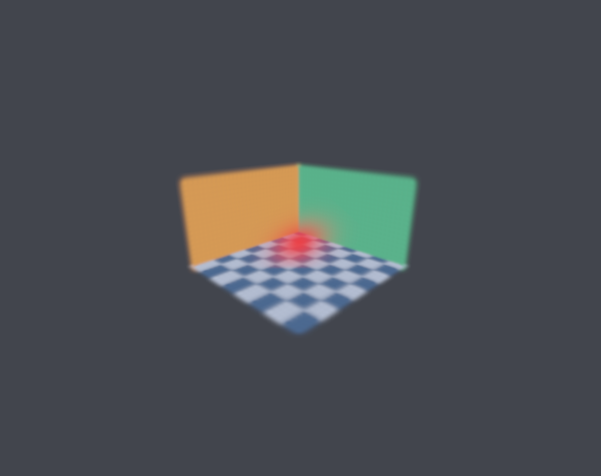

# Gazebo Gaussian Splatting

An Apache-2.0 Gazebo Harmonic GUI plugin from Solvor Labs that renders
anisotropic 3D Gaussian splats directly in an Ogre2 scene. Import a standard
3DGS/Splatfacto PLY, create a world, and inspect it with Gazebo's camera controls.
No ROS, training pipeline, CUDA, Redis, or Solvor Labs application is required
at runtime. ROS 2 Jazzy vendor libraries are supported as an installation path.



## Quick start

Install Gazebo Harmonic development dependencies (see [BUILD.md](docs/BUILD.md)), then:

```bash
python3 -m venv .venv
.venv/bin/pip install .
cmake -S . -B build -DCMAKE_BUILD_TYPE=Release -DCMAKE_INSTALL_PREFIX="$PWD/install"
cmake --build build -j2
ctest --test-dir build --output-on-failure
cmake --install build
.venv/bin/gzgs demo --output-dir demo-output
GZ_GUI_PLUGIN_PATH="$PWD/install/lib${GZ_GUI_PLUGIN_PATH:+:$GZ_GUI_PLUGIN_PATH}" \
  gz sim -r demo-output/room.sdf
```

For a ROS Jazzy installation, first `source /opt/ros/jazzy/setup.bash` so CMake
and `gz` can discover its vendor libraries. Use a Release build for large scenes.
Convenience commands: `bash scripts/build.sh`, then `bash scripts/run_demo.sh`.

## View your own reconstruction

```bash
.venv/bin/gzgs convert /path/to/splat.ply scene.gzgs
.venv/bin/gzgs inspect scene.gzgs
.venv/bin/gzgs world scene.gzgs scene.sdf
GZ_GUI_PLUGIN_PATH="$PWD/install/lib" gz sim -r scene.sdf
```

Use `--mode diagnostic` for a reference floor; `--mode captured` for calibrated
camera evaluation. See [USAGE.md](docs/USAGE.md) for embedding in an existing
world, live pose following, coordinate conventions and screenshots.

## Rendering

- Full 3D covariance projection into screen-space elliptical splats.
- Gaussian alpha falloff with depth testing against normal Gazebo geometry.
- Degree 0–3 RGB spherical harmonics.
- Camera-dependent back-to-front bucket depth ordering.
- Free-camera overview, diagnostic floor, and captured-camera modes.
- Strict standalone cache validation and streaming PLY import.
- Original synthetic scene included as a generator; no private datasets.

## Supported scope

The 0.1 series targets Linux, Gazebo Harmonic, Ogre2, Qt 5, C++17 and Python
3.10+. The GUI user camera renders splats; server-side camera sensors, RGB-D,
LiDAR, collision geometry and headless server rendering are **not** supplied by
this GUI plugin. A splat scene is a visual reconstruction, not a physics mesh.

Maximum cache size is two million Gaussians. SH attributes use 12-bit signed
quantization over [-8,8]; opacity uses eight bits. CPU depth sorting is throttled
to 10 Hz and uses 65,536 buckets, so it is not bit-exact gsplat rasterization.
See [LIMITATIONS.md](docs/LIMITATIONS.md) before using parity results.

## Development and distribution

Pure conversion tests require only Python's standard library. Native cache
tests can run with `-DBUILD_RENDERER=OFF`; the full plugin requires Gazebo/Ogre2.
See [CONTRIBUTING.md](CONTRIBUTING.md), [THIRD_PARTY.md](docs/THIRD_PARTY.md) and
[RELEASE.md](docs/RELEASE.md). The C++ plugin and Python CLI are installed
separately; `pip install` alone does not install the Gazebo shared library.
Local validation evidence and the remaining unvalidated configurations are
recorded in [VALIDATION.md](docs/VALIDATION.md).
